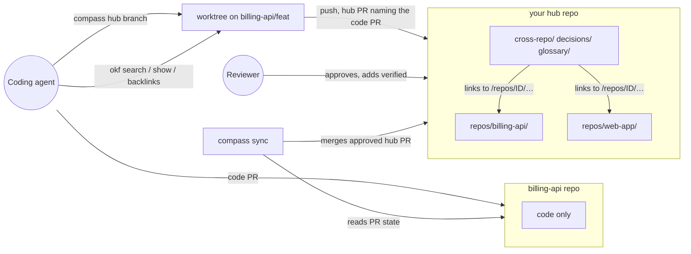
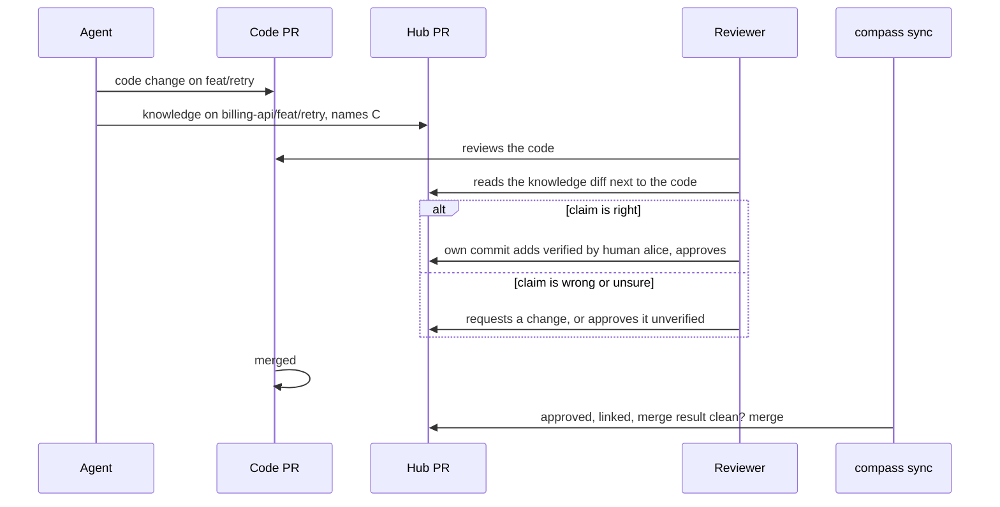
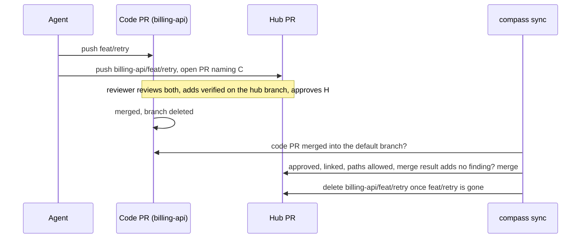
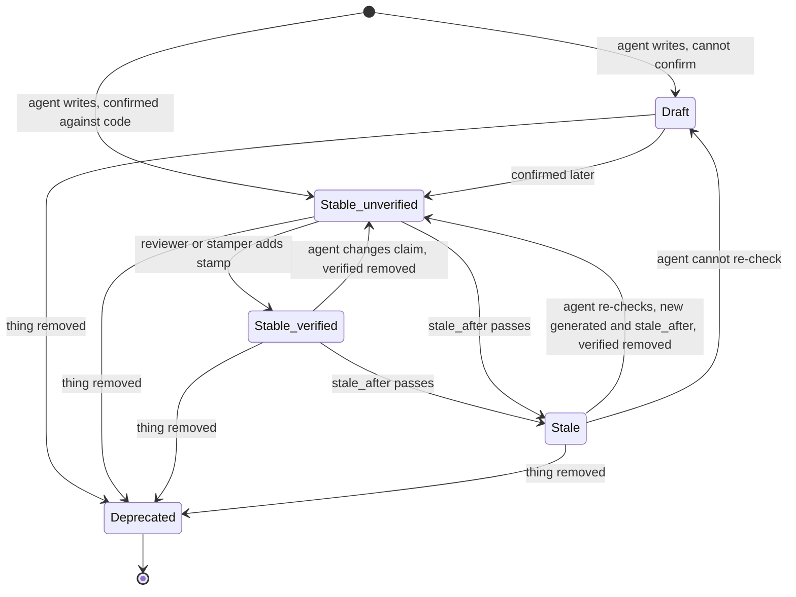

# How the OKF knowledge system works: interactions and UX

Date: 2026-09-29, revised 2026-10-21 for the hub-only design
([plan](../../plans/261021-1007-hub-branch-knowledge/plan.md)). Status:
design. It builds on the [research report](../research/okf-knowledge-system.md).
The tooling it describes is built into compass as one binary, `compass`, and
tested; the pilot on real repos has not started.

## Gist

The system adds no new app or server. People and agents use tools they already
have: markdown files in one hub repo, one CLI (`okf`), one agent skill, and
pull request review. All knowledge lives in the hub: each listed repo's
concepts under `repos/<id>/`, and knowledge that spans repos beside them. The
code repos carry nothing. It runs as a loop:

1. **Read.** Before a task in repo X on branch A, the agent runs
   `compass hub branch`, which prints the path of a local hub worktree on hub
   branch `X/A`. It reads what the hub knows there.
2. **Work and write.** The agent records what it learned in that worktree,
   then pushes `X/A` and opens a hub pull request that names A's code pull
   request (section 4.2).
3. **Review.** A human reads the hub pull request next to the code pull
   request, approves it, and can mark knowledge verified.
4. **Merge.** Once the code pull request merges, the next `compass sync`
   checks the merge result locally and merges the approved hub pull request.
   Agents run sync at the start of each session. Nothing runs in CI.

The main UX risks:

- Search results do not show trust or staleness, so the agent needs a second
  call.
- Knowledge is reviewed in a separate hub pull request. Reviewers may ignore
  it, so knowledge waits unmerged after its code ships.
- Until someone runs `compass sync`, approved hub pull requests stay open
  after their code merges.
- Two hub branches that add concepts to one folder conflict in a generated
  `index.md`. Resolving it changes the head, so the hub pull request needs a
  fresh approval.
- Code repos carry nothing, so an agent that never reads the pointer line in
  its user-level or organisation-level instructions finds no knowledge.
- Nothing stops an agent from writing a fake "human verified" stamp. Only
  review catches it.
- Upstream okfcli rejects the datetime `stale_after` this design uses
  (okfcli#34). Compass pins a patched fork, `tuan-nng/okf` release
  `v0.5.0-tuan-nng.1`, which accepts it in `okf validate` and reports
  `stale: true` in `okf show` once it passes. `compass setup` installs it. The
  same patch is open upstream as okfcli#39; we drop the fork once upstream
  releases a fix.

Command output in this document is real. It comes from the pinned fork
`v0.5.0-tuan-nng.1`, run on the test data in compass laid out as a hub, with
each repo's concepts under `repos/<id>/`: `testdata/fixture/`, rebuilt from
the research protocol's planted facts, and, for cross-repo queries,
`testdata/proto/`, the same data with the report's conventions.
`test/check-fixture.sh` checks both sets. The skill, `compass hub branch`,
`compass hub check`, the stamper (`compass stamp`) and `compass sync` are
built and tested. The stamper and `compass sync` have written nothing live
yet: their tests use recorded GitHub responses, and their live runs so far
were `--dry-run`. Section 9 lists what does not exist yet.

## 1. The original problem

The research set out to give coding agents a knowledge system that works
across 10–50+ repos. The research contract was only partly retrievable, so
this list is rebuilt from the report and its test protocol. It has five needs:

| # | Need | What goes wrong today |
|---|---|---|
| N1 | Agents start each task knowing why the code is the way it is | Every session starts blank. The agent re-derives knowledge or repeats a known mistake, such as retrying an invoice call without an idempotency key. |
| N2 | Agents can update that knowledge as a normal part of their work | What agents learn stays in chat logs and is lost |
| N3 | Humans can check agent-written knowledge cheaply | Agent notes are either trusted blindly or ignored |
| N4 | Knowledge covers how repos depend on each other | A change in one repo breaks another, and no single repo records the link |
| N5 | Knowledge stays current and portable across agents and tools | Notes rot, and a tool-specific store locks the team in |

Section 7 maps each need to the part of the system that meets it.

## 2. Who and what is involved

People and machines:

| Actor | Role |
|---|---|
| Coding agent | Claude Code, Cursor or omp, working in one repo with the skill loaded |
| Developer | Works next to the agent and asks it questions. Needs push access to the hub, because their agent pushes hub branches. |
| Reviewer | Reviews and approves hub pull requests, with write access to the hub. Is the only one who adds `verified: human:<login>` stamps. Runs `compass hub check` before approving a hub pull request that will be merged by hand. |
| Hub owner | One of the people `CODEOWNERS` names. Approves changes to `repos.txt`, `checks.txt` and `CODEOWNERS`, and runs `compass stamp`. |
| `compass sync` | Run by agents at the start of each session, with the developer's own GitHub token. Once a code pull request merges, it merges the paired hub pull request if a human approved it and its local check of the merge result finds nothing new. It reads the code repos and writes only to the hub. |
| The stamper (`compass stamp`) | Run by a hub owner. For each row of the hub's `checks.txt`, it asks the GitHub API whether a named CI job, such as a contract test against the OpenAPI file, passed on the head of the code repo's default branch. If it did, it commits a fresh `verified: process:<actor>` entry on each concept the row covers, under `repos/<id>/`. It is the only writer of `process:` stamps. It pushes to the hub's default branch, so it needs a ruleset bypass there. When the push is refused, it says so and exits non-zero. |

Artifacts:

| Artifact | Where | Written by |
|---|---|---|
| Your hub | A repo your team makes from compass's `templates/hub/`, such as `knowledge-hub/`: `repos.txt`, `checks.txt`, `repos/<id>/` for each listed repo, cross-repo dependencies, shared decisions, glossary. It holds no workflows and no credentials. | Agents and developers through hub branches; merged by `compass sync` or by a reviewer |
| Hub branch | `<id>/<b>` in the hub, paired with branch `<b>` of the repo that `repos.txt` names `<id>` | The agent creates it; `compass sync` deletes it when done |
| Hub worktree | `<hub clone>.worktrees/<id>/<b>`: a local git worktree of the hub on `<id>/<b>`, one per hub branch | `compass hub branch`; `compass hub branch --prune` removes finished ones |
| Skill | One `SKILL.md` that every agent loads; `compass setup` installs it | The platform team |
| Pointer line | `templates/user-pointer.md`, added once to each developer's user-level agent instructions and to each platform's organisation-level instructions. It is the only trigger, because code repos carry nothing. | Each developer, once per machine |



## 3. What each actor touches

| Actor | Uses | Never does |
|---|---|---|
| Coding agent | `compass hub branch`, then six commands in its worktree: `okf search`, `show`, `list`, `backlinks`, `index`, `validate`. Plain file edits. `compass hub check`, `git -C <worktree>` to commit and push, and `gh` to open the hub pull request. `compass sync` and `compass hub branch --prune` at the start of each session. | Adds a `verified` stamp, `human:` or `process:`; writes under another repo's `repos/<id>/`; changes the hub's control files; pushes to the hub's default branch |
| Developer | Reads the markdown on GitHub or in an editor. Asks the agent. Adds the pointer line once. | Needs to learn the CLI to benefit |
| Reviewer | The hub pull request, usually 1–3 knowledge files, linked to the code pull request. Adds one `verified` line in their own commit on the hub branch. `compass hub check` before approving one that will be merged by hand. | Approves a `verified: human:` line they did not write |
| Hub owner | Code-owner review of the control files; `compass stamp` with their own GitHub token | Runs the writers from CI; stores a write key |
| `compass sync` | The GitHub API for pull request states in the code repos and the hub; a local hub clone to build and check the merge result; merges approved hub pull requests with a merge commit; comments on hub pull requests; closes abandoned ones; deletes hub branches | Writes to a code repo, even a comment; merges a hub pull request before its code pull request merges, without a human approval, or when it adds a finding; opens hub pull requests itself |
| The stamper | The result of the named CI job on the code repo; one `verified` line per covered concept, in one commit chain on the hub | Stamps a concept its row in `checks.txt` does not list; writes to a code repo |

**The UX choice: the interface is the file.** Tools that rewrite frontmatter
made noisy diffs; one tag change became a 17-line diff (report, finding 6).
Plain file edits kept every change to 1–3 files. So reviewers read knowledge
changes the way they read code.

## 4. Journeys

### 4.1 An agent starts a task in one repo

The task: "Add retries to the invoice client in billing-api", on branch
`feat/retry`.

1. The pointer line in the agent's user-level or organisation-level
   instructions applies in every repo. It has the agent run
   `compass hub branch` in the repo root before starting work. Agents load a
   skill only when its description matches the task, and the code repo
   carries no file that mentions the hub, so the pointer line is the only
   trigger. [INFERENCE: skill auto-loading was not tested.]
2. `compass hub branch` matches the clone's `origin` against the hub's
   `repos.txt`, finds the id `billing-api`, and prints the path of a hub
   worktree on `billing-api/feat/retry`, creating it on the first run. The
   agent works in that path from here on. On the repo's default branch the
   command refuses and names the hub clone instead; the agent reads there and
   writes nothing (section 4.9).
3. The agent runs `compass sync`, then `compass hub branch --prune`. This
   merges any approved hub pull request whose code merged since the last
   session (section 4.9).
4. It reads `repos/billing-api/index.md`, then `repos/billing-api/overview.md`.
   The test data has no `overview.md`; section 4.8 shows how to add one.
5. It searches for the task's key words. Hits cover every repo; those under
   `repos/billing-api/` are this repo's:

   ```
   $ okf search . --text idempotency
   "count": 3,
   "results": [
     {"id": "repos/billing-api/contracts/invoice-api",   "title": "Invoice API v2", "type": "API Contract"},
     {"id": "repos/billing-api/gotchas/idempotency-key", "title": "Invoice creation needs an idempotency key", "type": "Gotcha"},
     {"id": "repos/billing-api/services/billing-api",    "title": "Billing API", "type": "Service"}]
   ```

6. Search hits show only the id, title and type. One `okf list .` call adds
   `status` and `trust_tier` for every concept in the hub, but not
   staleness. So the agent opens each hit it will rely on:

   ```
   $ okf show . repos/billing-api/gotchas/idempotency-key
   "description": "POST /v2/invoices double-charges on retry without Idempotency-Key.",
   "generated":   {"at": "2026-06-01T12:00:00Z", "by": "cursor/gpt-5.6"},
   "stale": true,
   "stale_after": "2026-09-01T00:00:00Z",
   "status": "draft",
   "trust_tier": "unverified"
   ```

7. The concept is a draft, unverified and stale. The agent treats it as a
   lead to check, not a fact (section 6). It reads the handler code and
   confirms that retries without the key double-charge.
8. The agent writes the retry code, and it sends the key.

This single read could prevent a double-charge bug. The agent still checked
the claim, because the concept's trust level told it to.

### 4.2 The agent records what it learned

The agent updates the knowledge in its hub worktree, on hub branch
`billing-api/feat/retry`.

1. It edits `repos/billing-api/gotchas/idempotency-key.md`. It sets
   `status: stable`, adds `sources` pointing at the handler, and adds a new
   `generated` stamp and a new `stale_after`. If the concept had `verified`
   entries, it removes them, because a stamp covers only the text that was
   checked (section 5):

   ```yaml
   status: stable
   generated: { by: claude-code/opus-5, at: 2026-09-29T14:00:00Z }
   stale_after: 2027-03-28T14:00:00Z
   sources:
     - id: create-invoice
       resource: https://github.com/acme/billing-api/blob/main/internal/invoice/create.go
   ```

2. It changes the root-relative link `/contracts/invoice-api.md` to
   `../contracts/invoice-api.md`. A link starting with `/` resolves from the
   hub root, so inside `repos/billing-api/` it is broken.
3. If it learned something new, for example a retry budget, it writes a new
   file, `repos/billing-api/gotchas/retry-budget.md`, with one concept in it.
4. It runs `okf index .` and `compass hub check .` at the worktree root. The
   check runs the strict validator and fails on a broken link, on an
   out-of-date `index.md`, and on any symlink. The research test of this path
   produced a 1–3 file diff (okfcli evidence, test T7).
5. It commits, pushes `billing-api/feat/retry`, and opens a hub pull request
   into the hub's default branch. Its description names the code pull
   request as `acme/billing-api#42` or by its URL; a short `#42` does not
   count, because the two pull requests live in different repos. It does not
   add `verified`. Both descriptions list the knowledge files it changed, so
   the reviewer can find them.

The index files are generated, so two hub branches often conflict in them.
In a test, conflicts appeared when both added concepts that sort next to each
other, when both created a folder, and when both edited concepts with adjacent
index rows. When a merge conflicts in an `index.md`, the agent takes either
side and re-runs `okf index .`; that gave a correct index every time
([evidence](../research/okf-knowledge-system/evidence/index-files.md)).
In `log.md` it keeps both entries. Neither validator notices an out-of-date
index, so `compass hub check` checks it.

What the agent must not record: facts the code already states plainly, copied
code, or secrets. Knowledge explains why, how things connect, and what
surprises people.

### 4.3 The reviewer checks and verifies



- The reviewer reads the knowledge change in a second pull request, linked
  from the code one. They need no other tool.
- Verifying adds one line on the hub branch. In the research test it produced
  a one-line diff, and the regenerated index files did not change.
- The approval must be on the hub pull request's current head. Any later
  push, such as a conflict fix, needs a fresh approval.
- After merge, `okf list` and `okf show` report `trust_tier: human-reviewed`.
  Future agents treat the concept as reliable.
- A reviewer may approve knowledge unverified. Unverified knowledge is still
  useful. Agents just check it first.
- Knowledge nobody approved does not ride along with the code; it waits.
  `compass sync` merges a hub pull request only after a human approved it.
- The proof of who added a `human:` stamp is the hub pull request, not the
  commit. So a later check should match the stamp's login against the
  reviewers who approved that pull request, not against commit authors.

A hub pull request that no code branch pairs with, such as a fix to a
hub-level concept, is merged by a reviewer by hand. `compass sync` never
checks it, so the reviewer runs `compass hub check` on its branch before
approving.

### 4.4 An agent answers a cross-repo question

The task, in billing-api: "Change the response shape of POST /v2/invoices."
The agent first asks who depends on that contract.

1. A single repo cannot answer this, but the hub can: every listed repo's
   merged knowledge is already in it, with no copy step. The agent
   queries its worktree, which branched from the hub's default head. On a
   default branch, it queries the hub clone after pulling it.
2. It asks for backlinks, meaning every concept that links to this one:

   ```
   $ okf backlinks . repos/billing-api/contracts/invoice-api
   "backlinks": [
     "cross-repo/invoice-dependency",
     "repos/billing-api/gotchas/idempotency-key",
     "repos/billing-api/services/billing-api"],
   "count": 3
   ```

3. Only `cross-repo/…` and `repos/<other repo>/…` entries are dependents. The
   other two are billing-api's own concepts. The one dependent here is
   `cross-repo/invoice-dependency`, a hub concept verified by `human:alice`.
   It says: "Breaking changes to the contract need a web-app release first."
4. The agent stops before the breaking change. It tells the developer that
   web-app must ship first, citing the concept. It can then offer an additive
   change instead.

At 10,000 concepts, search took 0.37 s and backlinks 0.34 s (medians). So the
agent can run these checks by default. Knowledge still waiting in other
repos' open hub pull requests is not visible until it merges.

### 4.5 Recording a cross-repo fact

Say the agent finds, while working in web-app on `feat/checkout`, that
checkout now also calls shared-auth's session endpoint.

1. In its worktree on `web-app/feat/checkout`, it records web-app facts under
   `repos/web-app/`. Those concepts do not link to shared-auth's files; they
   may cite shared-auth by GitHub URL.
2. In the same worktree, it adds
   `cross-repo/web-app-session-dependency.md`, with type
   `Cross-Repo Dependency`, linking `/repos/web-app/…` and
   `/repos/shared-auth/…`.
3. `compass hub check .` fails on any broken link. A link to a web-app
   concept added on this branch resolves at once, because both changes are on
   the same hub branch and merge together.

Cross-repo links live only in hub-level concepts, because the OKF spec has no
way to link between bundles (report, finding 4). This rule keeps each repo's
folder valid when read on its own. `compass sync` also refuses a hub branch
that changes another repo's `repos/<id>/`, so a branch for web-app cannot
edit shared-auth's knowledge.

### 4.6 Knowledge goes stale or turns out wrong

| Trigger | What the agent does |
|---|---|
| The code contradicts a concept | Fixes the concept in the same change (section 4.2) |
| The concept is past `stale_after` | Checks the claim against the code, then updates `generated` and `stale_after` and removes any `verified` entries, so a reviewer verifies again. If it cannot check the claim, it sets `status: draft` and says why. |
| The thing described was removed | Sets `status: deprecated`. It does not delete the file, so inbound links still resolve. |
| The agent cannot reach the code, such as another repo's internals | Sets `status: draft` and gives the reason in the body |

`stale_after` is required for `API Contract` and `Gotcha`. The default is 180
days. `okf show` reports `stale: true` for these concepts once the date
passes. Stale concepts come up as agents meet them during tasks, not in a
separate cleanup job.

This design keeps the spec's datetime form of `stale_after`. Upstream okfcli
accepts only a date-only value (okfcli#34); the pinned fork accepts both.

### 4.7 Renaming or moving a concept

Moves should be rare. They are a manual, human-led step, on a hub branch for
the repo whose concept moves:

1. Before moving, run `okf backlinks` in the worktree for the old path. Note
   the hub concepts in the result (`cross-repo/…`, `decisions/…`).
2. Run `okfctl node mv <old> <new> --bundle . --dry-run` at the worktree
   root, then run it for real. It rewrites inbound links, appends to
   `log.md` and regenerates the index files, replacing the root `index.md`
   prose. Run `okf index .` afterwards so the index files match what okfcli
   writes. [INFERENCE: not tested on the hub layout, where the whole hub is
   one bundle and the rewrite reaches hub-level concepts too.]
3. Fix any link from step 1 that is still broken. `compass hub check .`
   fails on any link that was missed, before the hub pull request opens, and
   `compass sync` checks the merge result again before merging.

### 4.8 Adding a repo

1. Add `<id> <GitHub URL>` to the hub's `repos.txt`, through a hub pull
   request that a code owner approves and merges by hand.
2. Nothing changes in the code repo: no folder, workflow, hook or instruction
   file. Developers who already have the pointer line need nothing more.
3. Optionally, the same hub pull request adds `repos/<id>/overview.md` (type
   `Overview`) and runs `okf index .` at the hub root. That writes
   `repos/<id>/index.md` and updates `repos/index.md` and the root
   `index.md`. Otherwise the folder appears with the first hub branch that
   writes to it.

Agents then fill in knowledge as they work. The okf-skills `backfill`
command can draft concepts from git history as `status: draft`, but it was
not tested.

### 4.9 Working on a branch

Hub branch `<id>/<b>` pairs with branch `<b>` of the repo that `repos.txt`
names `<id>`. The [plan](../../plans/261021-1007-hub-branch-knowledge/plan.md)
has the full sync state table. This is how it feels in use.

1. The first `compass hub branch` on a code branch creates the hub worktree.
   An existing local `<id>/<b>` is reused. A `<id>/<b>` a teammate pushed is
   tracked, so the teammate's knowledge comes along. Otherwise the branch
   starts from the hub's remote default head. Later runs print the same path
   and create nothing.
2. Switching code branches needs nothing extra. Each code branch has its own
   worktree, and the agent runs `compass hub branch` again to get its path.
3. Before reading in a worktree that tracks a remote branch, the agent pulls
   teammates' commits, when its tree is clean.
4. The agent reads and writes as in sections 4.1 and 4.2, then pushes the code
   branch and `<id>/<b>`, and opens the hub pull request.
5. The reviewer reviews both pull requests (section 4.3). When the code pull
   request merges into the repo's default branch, the next `compass sync`
   run:
   - reads the code pull request's state;
   - fetches the hub;
   - checks that the hub branch changes only `repos/<id>/`, `repos/index.md`
     and hub-level files other than the control files, and adds no symlink
     or submodule;
   - builds the merge of the default head and the hub branch, without
     running the user's git hooks or filters, and runs `compass hub check` on
     it;
   - re-reads the default head, and merges with the head SHA it checked.

   If anything blocks the merge, sync comments on the hub pull request once
   per blocker and tries again next run.
6. Once `<b>` is gone from the code repo's remote, sync deletes the hub
   branch, and the next `compass hub branch --prune` removes the worktree.



Things to know:

- On the repo's default branch, or with a detached HEAD, `compass hub branch`
  refuses. On the default branch it names the hub clone, which the agent
  reads from; knowledge is written only through a hub branch.
- A code pull request from a fork never pairs. Its hub branch is closed as
  abandoned once the code branch has been gone 7 days.
- Git cannot hold both `<id>/feat` and `<id>/feat/x`. While a local or
  remote `<id>/feat` exists, `compass hub branch` on `feat/x` refuses and
  names it.
- Knowledge on a hub branch is visible only there until sync merges it.

## 5. Life of a concept

The spec defines `status` as one of `draft`, `stable` or `deprecated`. Trust
is separate: tools derive a `trust_tier` from the `verified` entries. The tiers
are `unverified`, `machine-confirmed` (a `process:` verifier, written by the
stamper) and `human-reviewed`. In the diagram, `Stable_verified` covers both
verified tiers.



A `verified` entry covers only the text that was checked. The tools do not
track this: in a test, a concept whose `verified.at` was older than its
`generated.at` still showed `trust_tier: human-reviewed`. So the skill adds two
rules:

- Whenever an agent writes a new `generated` stamp, it removes the concept's
  `verified` entries and says so in the hub pull request. The reviewer can
  then verify again, and the stamper re-confirms after merge. Agents may
  remove a stamp; they never add one, `human:` or `process:`.
- When reading, the agent counts a `verified` entry only if its `at` is at or
  after `generated.at`. This catches edits that skipped the first rule.

## 6. How the agent decides what to trust

The skill turns the fields on a concept into an action. Check the rows in
order; the first match wins. "Stale" means `stale_after` is in the past;
`okf show` reports it as `stale: true`. A `verified` entry
counts only if its `at` is at or after `generated.at` (section 5).

| Concept | Agent behavior |
|---|---|
| `deprecated` | Do not follow it. Look for what replaced it. |
| `draft`, or stale | Treat it as a lead only. Confirm it, then fix or refresh it (section 4.6). |
| `human-reviewed` | Rely on it. Cite it when it drives a decision. |
| `machine-confirmed` | Rely on it for what the machine check covers, such as a contract matching its OpenAPI file |
| `unverified` | Use it as a strong lead. Confirm against the code before a risky change. |

Two rules for backlinks:

- Empty backlinks can mean no links or a mistyped ID. okfcli returns
  `count 0` in both cases, so check the ID with `okf list`.
- In the hub, only `cross-repo/…` and `repos/<other repo>/…` entries are
  dependents. Entries from the concept's own repo are not.

## 7. How this solves the original problem

| Need | Mechanism | Evidence | What remains |
|---|---|---|---|
| N1: agents start informed | The pointer line in user-level or organisation-level instructions, the only trigger; `compass hub branch`; skill step "before starting work"; search, then list or show; trust rules in section 6 | Search 0.37 s and backlinks 0.34 s at 10,000 concepts; correct hits on the test data | Search hits lack trust and status, so the agent needs a second call; plain substring matching with no ranking; an agent that misses the pointer line finds nothing |
| N2: agents update knowledge in normal work | Plain file edits in a hub worktree on `<id>/<b>`, `okf index .` and `compass hub check .`, and a hub pull request that names the code pull request | 1–3 file diffs; unknown frontmatter keys kept on disk | `okf index` overwrites hand-written `index.md` prose, so prose goes in `overview.md`; `compass sync` has merged nothing live yet (tested on recorded GitHub responses, run live only as `--dry-run`) |
| N3: cheap human checks | A hub pull request linked to the code pull request; a one-line `verified` stamp; stamps removed when the claim changes; `compass hub check` before each commit and inside sync before each merge | A one-line verify diff; strict validator clean on the prototype | Nothing enforces who writes a `human:` stamp. Review is the only check; a later check could match the stamp's login against the hub pull request's approving reviewers (section 4.3). The reviewer must open a second pull request, and knowledge waits until someone approves it. |
| N4: cross-repo knowledge | Every repo's knowledge and the hub's `Cross-Repo Dependency` concepts in one hub, queried with `okf backlinks`, checked by `compass hub check` | 3 correct backlinks on the prototype hub, including the cross-repo edge; `compass hub check` took 1.25 s on the 10,000-concept scale hub (ad hoc run, 2026-10-21) | Anyone who reads the hub reads every listed repo, so separate access groups need separate hubs; `compass hub branch` timing on a real hub is unmeasured until the pilot |
| N5: current and portable | `stale_after`, `deprecated`, and agents fixing contradictions as they go; plain OKF files; skill depends on six commands | Every tool read the same files; a CLI swap only touches the skill | Staleness detection relies on the pinned fork until upstream okfcli fixes okfcli#34 |

## 8. What users see when something breaks

| Failure | What the user or agent sees | Handling |
|---|---|---|
| A symlink in the hub | Tools follow it, so a check could read files outside the hub | `compass hub check` fails on any symlink and runs no other check while one exists. Sync refuses a hub branch that adds a symlink or submodule link, before reading its files. |
| A repo concept uses a `/…` link | Reported broken: `/` resolves from the hub root | `compass hub check` reports it. The skill allows only relative links under `repos/<id>/`. The re-run test data shows exactly this finding for `idempotency-key`. |
| `stale_after` in the spec's datetime form, with upstream okfcli (okfcli#34) | `okf validate` errors; `okf show` says `stale: false` for a stale concept | Compass pins a patched fork, `v0.5.0-tuan-nng.1`, and `compass setup` installs it. The fork accepts datetimes and reports `stale: true`. |
| Agent writes `verified: human:…` itself | Concept shows as `human-reviewed` | Caught only in review. The skill forbids it. |
| Agent changes a reviewed concept but keeps its `verified` entry | Tools still show `human-reviewed` | The skill ignores a stamp older than `generated.at` (section 5). The reviewer sees the kept stamp in the diff. |
| Search term inside backticks, such as `` `Idempotency-Key` `` | okfcli finds it; okf-mcp did not | Re-test any replacement search tool against this case |
| Moved file breaks links | `compass hub check .` fails in the worktree; sync refuses a merge result with the new finding | Section 4.7 |
| Concept added or edited without re-running `okf index .` | `compass hub check` reports the stale `index.md` | Run `okf index .` and commit |
| Two hub branches change the same folder | Merge conflict in a generated `index.md` or in `log.md`; sync comments "conflict" on the hub pull request | Merge the hub's default branch into the hub branch, take either side of `index.md` and re-run `okf index .`, keep both `log.md` entries, push. The new head needs a fresh approval. |
| A branch is valid alone but breaks a link once merged | Sync comments with the findings the merge result adds, and does not merge | Fix the link on the hub branch and push |
| A hub branch changes another repo's folder or a control file (`repos.txt`, `checks.txt`, `CODEOWNERS`, `.github/`, …) | Sync comments with the paths and does not merge | Move that change to its own hub pull request, which a reviewer merges by hand |
| The hub's default branch is already broken | `compass hub check` fails on the default branch | Sync keeps merging branches that add no new finding. The fix is a hub pull request a reviewer merges by hand after `compass hub check` passes on it. |
| The default branch moves between sync's check and its merge | Usually sync sees the move and skips the branch until the next run | In a short window an unchecked result can merge; the next `compass hub check` reports it, and a follow-up hub pull request fixes it |
| Code merged, hub pull request not approved | The hub pull request stays open; sync comments on it | Approve it; the next `compass sync` run merges it |
| Code merged, no hub pull request for a hub branch with commits | Sync prints "needs a hub pull request" in its own output | Open the hub pull request naming the code pull request |
| Code merged, hub pull request closed unmerged | Sync prints "hub pull request rejected" and deletes the hub branch once the code branch is gone | Nothing, unless the knowledge should land after all |
| Code pull request closed unmerged, or code branch abandoned | Sync comments on and closes the hub pull request and deletes the hub branch: at once for a closed code pull request whose branch is gone, after 7 days for a branch with no code pull request | Nothing |
| Code pull request from a fork | Never pairs; its hub branch closes as abandoned after 7 days | The skill tells the user before writing knowledge |
| GitHub down, rate-limited, or a code repo the developer's token cannot read | Sync fails that repo's branches with the reason, goes on with the others, and exits 1 | The skill reports it and carries on with the task. Every action is safe to repeat. |
| A worktree holds uncommitted or unpushed work when its hub branch is gone | `compass hub branch --prune` keeps it and prints its path and the reason | Push it and open a hub pull request, or discard it by hand |
| Agent on the repo's default branch | `compass hub branch` refuses and names the hub clone | The agent reads from the hub clone and writes nothing |
| Repo not in `repos.txt` | `compass hub branch` refuses and prints the origin URL | The skill does not apply, except for cross-repo questions |
| CI or cloud agent without the pointer line | The agent works without the hub's knowledge | Each CI and cloud agent environment runs `compass setup`, and the platform's organisation-level instructions carry the line from `templates/user-pointer.md` (section 9) |
| Nobody runs `compass sync` | Approved hub pull requests stay open after their code merges; hub branches pile up | Agents run it at the start of each session. Nothing alerts on this; the pilot measures it (section 9). |
| Private hub on GitHub Free | No ruleset, so any writing developer can push to the default branch or merge an unapproved pull request | Make the hub public if its knowledge allows, or use a paid plan; otherwise approval holds by convention only |
| A repo is removed from `repos.txt` | Its hub branches are no longer scanned | Close its hub pull requests and remove `repos/<id>/` by hand |

## 9. What does not exist yet

These are needed before the journeys above work end to end. Section 8 of the
report lists the open work as it stood before the hub-only design.

1. The skill in use. It is built (`skill/okf/SKILL.md` in compass, installed
   by `compass setup`) from the section 6 outline in the report and sections
   4.1–4.6, 4.9, 5 and 6 of this document, but no agent has used it on a real
   repo. If the skill ever reads custom frontmatter keys, also okfcli#35:
   `okf show` drops them.
2. A live sync merge and a live stamp. `compass sync` and the stamper are
   built and tested on recorded GitHub responses and a local hub clone, and
   have run live only as `--dry-run`. The test data has one
   `process:ci-contract-test` stamp, but no stamper run wrote it.
3. A real hub at size. `compass hub check` took 1.25 s on the generated
   10,000-concept scale hub. Neither it nor `compass hub branch` has run on a
   real hub cloned from GitHub.
4. CI and cloud agents finding the hub through the organisation-level pointer
   line. No real CI or cloud agent has run it yet.
5. A pilot with 2–3 repos, measuring:
   - how often agents write knowledge;
   - how often reviewers correct it;
   - how often agents run into stale concepts;
   - how often each concept loses its `verified` stamp to an edit and has to
     be re-verified;
   - how often a hub pull request is still open a day after its code merged.
